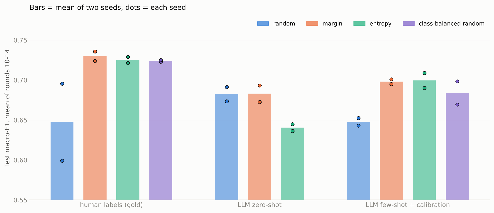
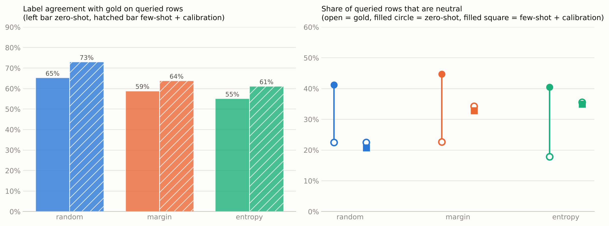

# bangla-sentiment-active-learning

Can an LLM replace the human annotator inside an active-learning (AL) loop for Bangla sentiment classification, and can the LLM annotator be improved?

Everything here uses one dataset, **SentiGOLD**, collapsed to 3 classes (neutral / positive / negative). The classifier is BanglaBERT; the LLM annotator is Qwen2.5-7B-Instruct.

> **Status: work in progress, not peer reviewed.** Two seeds (17 and 18) for the main comparison, one seed for the annotator-tuning steps. The dataset text is not included (see [Data](#data)).

## The question, in plain words

Active learning picks the rows that look most useful (for example, the ones the model is least sure about) and asks an annotator to label only those. With human labels this saves effort. If the annotator is an LLM instead, its labels on exactly those hard rows may be wrong more often, and the gain can disappear. This repo measures that, then tries to fix the annotator step by step.

## What was done, in order

| Step | Notebook | What it does | Why |
|---|---|---|---|
| 0. Classifier baseline | `00_sentigold_qwen_zero_few_shot_classifier` | Qwen zero-shot and few-shot on the locked test set | Is Qwen usable as a classifier at all? |
| 1. AL with human vs zero-shot LLM labels | `01_sentigold_al_human_vs_zero_shot_llm_labels` | Same AL loop; queried rows labeled by gold ("human") or Qwen zero-shot ("llm") | Does the AL gain survive LLM labels? |
| 2. Improve the annotator (benchmark, calibration, few-shot, retrieval) | `02_annotator_tuning_calibration_fewshot_retrieval` | Builds a fixed 1,707-row benchmark, then tests calibration, a few-shot prompt and retrieved examples (null result) | Which part of the gap can be closed? |
| 3. AL with the tuned annotator, class-balanced control, seed 18 | `03_al_with_tuned_annotator_two_seeds` | AL runs with the frozen few-shot + calibration annotator and the class-balanced random control, then all runs repeated with seed 18 | Are the results stable? |
| 4. Error analysis | last cell of notebook 03, and `analysis/error_types.py` | Read where Qwen's label disagrees with gold | Why is the gap not closed? |

## Setup

- **Data**: 3-class SentiGOLD, subsampled to about 15.7k rows (2 to 99 characters). Stratified 80/10/10 split with seed 17. The 1,570-row test set stays locked. Train + validation is the labeled pool (about 14.1k rows).
- **AL loop**: 200 stratified seed rows from the pool, then 100 queried rows per round for 15 rounds. BanglaBERT (`csebuetnlp/banglabert`) is fine-tuned from the pre-trained weights every round (3 epochs, learning rate 2e-5, batch size 16, max length 64).
- **Strategies**: random, margin, entropy, and a class-balanced random control (random picks, but each round forced to the class mix of the human margin run; it uses gold labels to sample, so it is a diagnostic, not a usable strategy).
- **Metric**: macro-F1 and accuracy on the locked test set, reported as the mean of rounds 10 to 14 (rounds are noisy, 1 to 2 F1 points).
- **Seeds**: the seed controls the 200-row seed set, BanglaBERT training and random picks. The test set is fixed.
- **LLM annotator**: Qwen2.5-7B-Instruct, 4-bit (NF4), left padding. The label is the highest of the log-scores of the first tokens of "neutral", "positive", "negative". There is no text parsing and no fallback label.
- **Checkpointing**: each round is saved atomically with the random-number-generator state, so interrupted runs resume with the same later picks.

## Results

### 1. Qwen as a classifier (locked test set, 1,570 rows)

| Prompting | macro-F1 | accuracy |
|---|---|---|
| Zero-shot | 0.666 | 0.669 |
| Few-shot (4 per class, from the 200-row seed set) | 0.707 | 0.723 |

### 2. Does AL gain survive LLM labels? (macro-F1, mean of rounds 10 to 14)

| Annotator | Strategy | Seed 17 | Seed 18 | Mean |
|---|---|---|---|---|
| human | random | 0.696 | 0.599 | 0.647 |
| human | margin | 0.736 | 0.724 | 0.730 |
| human | entropy | 0.729 | 0.721 | 0.725 |
| human | class-balanced random | 0.723 | 0.725 | 0.724 |
| LLM zero-shot | random | 0.691 | 0.673 | 0.682 |
| LLM zero-shot | margin | 0.693 | 0.673 | 0.683 |
| LLM zero-shot | entropy | 0.645 | 0.636 | 0.641 |
| LLM few-shot + calibration | random | 0.652 | 0.643 | 0.648 |
| LLM few-shot + calibration | margin | 0.695 | 0.701 | 0.698 |
| LLM few-shot + calibration | entropy | 0.709 | 0.690 | 0.699 |
| LLM few-shot + calibration | class-balanced random | 0.699 | 0.670 | 0.684 |

How to read this:

- **With human labels, margin and entropy beat random by +8 F1 points on average, but this is mostly a class-mix effect.** Against the class-balanced random control the gain is only +0.6 (margin) and +0.1 (entropy). The human-random run on seed 18 is a low outlier (0.599), which inflates the gap to plain random; the seed-17 gap is +4.0 and +3.3.
- **A zero-shot LLM annotator loses the gain and makes entropy sampling worse than random** (-4.2 F1 points on average).
- **Few-shot + calibration recovers part of it**: the gap to human labels on entropy goes from +8.5 to +2.6 F1 points, and on margin from +4.7 to +3.2. The best LLM-only runs (0.698 to 0.699) are still about 3 points below the human-label runs (0.725 to 0.730).
- Few-shot + calibration is *worse* than zero-shot for random picking (0.648 vs 0.682). I do not have an explanation for this yet (see [Limitations](#limitations)).

### Label quality on the queried rows

| Annotator | Strategy | Agreement with gold (mean of 2 seeds) | Share labeled neutral | Gold neutral share |
|---|---|---|---|---|
| LLM zero-shot | random | 0.653 | 0.412 | n/a |
| LLM zero-shot | margin | 0.589 | 0.447 | n/a |
| LLM zero-shot | entropy | 0.551 | 0.404 | n/a |
| LLM few-shot + cal. | random | 0.730 | 0.208 | 0.225 |
| LLM few-shot + cal. | margin | 0.639 | 0.329 | 0.343 |
| LLM few-shot + cal. | entropy | 0.612 | 0.350 | 0.355 |
| LLM few-shot + cal. | class-balanced random | 0.697 | 0.260 | 0.355 |

The better annotator is still wrong on about 36 to 39% of the rows that margin and entropy query, because those are the hard rows.

## Annotator improvement

The annotator was improved with a fixed 1,707-row benchmark: rows sampled from those queried in the zero-shot LLM runs (600 random, 563 margin, 544 entropy), disjoint from the 200 seed rows.

| Variant | accuracy | macro-F1 |
|---|---|---|
| Zero-shot | 0.619 | 0.617 |
| Zero-shot + calibration | 0.670 | 0.638 |
| Fixed few-shot, 12 examples (3 draws) | 0.677 | 0.656 |
| Fixed few-shot + calibration | 0.686 | 0.659 |
| Retrieved examples (k=12) | 0.664 | 0.645 |
| Retrieved examples + calibration | 0.665 | 0.634 |
| Random examples (k=12) | 0.637 | 0.623 |
| Random examples + calibration | 0.665 | 0.639 |

- **Problem found**: zero-shot Qwen labels 42% of the benchmark rows neutral, while gold neutral is 23%.
- **Calibration**: add a fixed offset to the neutral and negative log-scores (positive fixed at 0). The offsets are fit by cross-entropy on seed rows only, using the 188 seed rows that are not in the few-shot prompt, so the prompt examples do not leak into the fit. Calibration alone raises accuracy from 0.619 to 0.670.
- **Few-shot**: 12 fixed examples (4 per class) from the seed rows. Three different draws were tested; the numbers above are averages over the draws.
- **Retrieved examples (a RAG-style test, null result)**: BGE-M3 embeddings of the 200 seed rows, the 12 nearest seed rows of each query row as the examples. With calibration it matched random examples (difference 0.000, 95% CI -0.018 to +0.018 in accuracy) and was slightly below the fixed few-shot prompt, so it was not used.
- **Not tested**: a stronger LLM, a longer guideline-style prompt, and fine-tuning the annotator.

## Error analysis (where Qwen and gold disagree)

Read from the four few-shot margin/entropy runs (6,000 labeled rows, 2,249 disagreements, 37.5%). The error-type shares come from all disagreements. The readings of single sentences come from a 40-row sample and are qualitative, not measured rates. The sentences are not quoted here because the dataset license is not stated.

- **About 76% of the disagreements involve the neutral class**: gold positive to Qwen neutral 23.5%, gold neutral to Qwen positive 21.5%, gold neutral to Qwen negative 17.9%, gold negative to Qwen neutral 13.4%. Only about 24% are direct positive/negative flips. The errors run in both directions, so this is not just a neutral bias, which is why shifting the neutral offset alone cannot fix them.
- **Gold often follows the implied event, Qwen reads the sentence literally.** Factual or news-like sentences about something bad (floods, disease spread, crime) are often gold negative and Qwen neutral. Sentences about a favorable outcome (a permission granted, extra time available) are often gold positive and Qwen neutral.
- **Qwen reacts to surface words**: for example, "destroyed" in a sentence about germs dying, or words about crying in a sentence with a happy ending. It also read an emoji-marked sarcastic sentence as positive.
- **Some are real Qwen misses**, including an insulting joke comparing a political leader to an animal that Qwen called neutral with confidence 1.00.
- **Some gold labels look debatable**, and some rows are truncated or garbled, so no label is reliably right.
- **Qwen's confidence is not a useful warning**: 53.7% of all 2,249 wrong rows had confidence of 0.95 or higher (`analysis/error_types.py`).

These rows were chosen by BanglaBERT's margin or entropy, so they are hard rows, not typical data.

## Limitations

- Two seeds for the AL comparison, one seed (17) for the annotator tuning. Differences of 1 to 2 F1 points are inside round-to-round noise.
- The few-shot examples, the calibration offsets and the choice among variants were all made on the same benchmark, so the benchmark numbers for the chosen annotator are somewhat optimistic. A fresh held-out set has not been used yet.
- The human-random run on seed 18 is an outlier (0.599, accuracy 0.702) and inflates the "gain over random" for human labels.
- Few-shot + calibration hurts random picking (0.648 vs 0.682 for zero-shot). I could not explain this: the neutral share matched gold on seed 18 and F1 was still low.
- The class-balanced control uses gold labels to sample, so it is a diagnostic only.
- SentiGOLD is subsampled to about 15.7k rows and texts under 100 characters.
- The error-analysis readings come from 40 rows read by hand.

## Data

SentiGOLD is not redistributed here. Download it from Hugging Face: `SayedShaun/sentigold` (Islam et al. *SentiGOLD: A Large Bangla Gold Standard Multi-Domain Sentiment Analysis Dataset and Its Evaluation.* KDD 2023). The dataset page did not state a license when checked; check the terms before redistributing any text.

Five classes are collapsed to three: strongly/weakly positive to positive (1), strongly/weakly negative to negative (2), neutral stays (0). Rows with 2 to 99 characters are kept, duplicates are dropped, and a class-stratified sample of about 15.7k rows (15,699 obtained) is split 80/10/10 with seed 17.

The annotation logs in `results/` replace each sentence by `sent_id` (first 12 hex characters of the SHA-1 of the UTF-8 sentence) and `n_chars`, so rows can be re-linked by anyone who has the dataset.

## Repository layout

```
notebooks/   Colab notebooks (GPU runtime), numbered in the order the work was done
scripts/     benchmark builder, log anonymizer
analysis/    summarize_runs.py (tables), error_types.py (mistake types), plot_runs.py (figures); no GPU needed
results/     curves/  annotations_anon/  annotator/ (offsets, shot ids)  benchmark/
figures/     fig1_curves.png  fig2_summary.png  fig3_annotator.png
```

Reproduce the tables and figures from the saved results:

```
pip install -r requirements.txt
python analysis/summarize_runs.py --results results
python analysis/error_types.py --results results
python analysis/plot_runs.py --results results --out figures
```

File names in `results/` follow `sentigold_s<seed>_<annotator>_<strategy>`; annotator is `human`, `llm` (zero-shot) or `llm_fs` (few-shot + calibration).
`results/annotator/step5_annotator*.json` hold the calibration offsets and the few-shot example ids (sentences removed). The zero-shot offsets are in `step2_offsets.json`.
To re-run the experiments, open the notebooks in Colab with a GPU runtime. Package versions were whatever Colab provided at the time and are not pinned. Qwen 4-bit loading needs `bitsandbytes>=0.46.1`. The notebooks read and write checkpoints on Google Drive (`/content/drive/MyDrive/llm_results`), so every run can resume after a disconnect. Total GPU time for the recorded new runs was about 25 hours on a T4.





## Next steps

1. Test the final annotator once on fresh held-out rows for an unbiased number.
2. Add the annotation guideline's rules (for example, how factual statements with good or bad implications are labeled) to the prompt and test it.
3. Try a stronger LLM as annotator.
