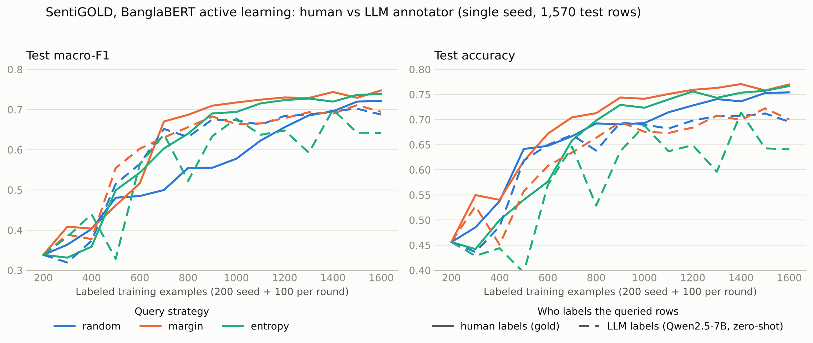
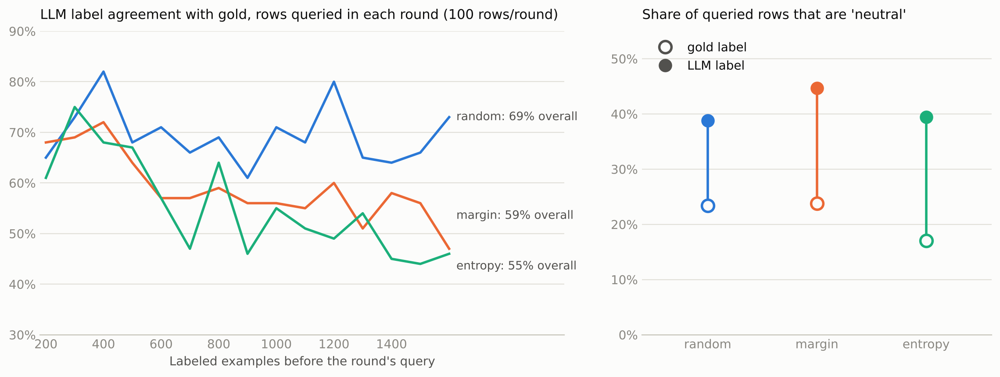

# bangla-sentiment-active-learning

Active learning for Bangla sentiment classification with BanglaBERT, and a test of whether an LLM (Qwen2.5-7B-Instruct) can replace the human annotator inside the loop.

> **Status: work in progress.** All active-learning results below use a single seed (17) and have not been peer reviewed.
> The dataset text is not included in this repo (see [Data](#data)).

## What is in here

| Part | Dataset | What it does |
|---|---|---|
| Layer 2 | SentNoB | Active learning with BanglaBERT; queried rows get their gold label (a simulated human annotator). Strategies: random, margin, entropy |
| Layer 3a | SentNoB | Zero-shot and few-shot Qwen2.5-7B-Instruct as a classifier on the locked test set |
| Layer 3b | SentiGOLD (3 classes) | The same loop, but queried rows are labeled either by the gold label ("human") or by Qwen zero-shot ("llm") |

## Main results so far (Layer 3b, SentiGOLD)

Test set: 1,570 rows, 3 classes. BanglaBERT is retrained from scratch each round on 200 seed rows plus 100 queried rows per round. After the last evaluated round it has seen 1,600 labels.

| Annotator | Strategy | macro-F1 @1600 | accuracy @1600 | macro-F1, mean of rounds 10-14 | accuracy, mean of rounds 10-14 |
|---|---|---|---|---|---|
| human | random | 0.722 | 0.754 | 0.696 | 0.742 |
| human | margin | 0.748 | 0.770 | 0.736 | 0.764 |
| human | entropy | 0.738 | 0.767 | 0.729 | 0.755 |
| llm | random | 0.687 | 0.696 | 0.691 | 0.704 |
| llm | margin | 0.694 | 0.700 | 0.693 | 0.703 |
| llm | entropy | 0.642 | 0.641 | 0.645 | 0.649 |

What the logs show:

- **LLM labels cost accuracy, and uncertainty sampling makes it worse.** Agreement between the LLM label and the gold label on the rows each strategy queried is 69.5% (random), 59.0% (margin) and 55.3% (entropy), and it falls over the rounds for margin and entropy.
- **The gain from active learning does not survive LLM labels.** With gold labels, margin and entropy beat random by +4.0 and +3.3 macro-F1 points (mean of rounds 10-14). With LLM labels the same differences are +0.2 and -4.7.
- **The LLM over-predicts neutral.** It labels 39% / 45% / 39% of the queried rows (random / margin / entropy) as neutral, while gold neutral is 23% / 24% / 17%. This is a systematic bias, not random noise.
- Checked and clean: queried-row length is about the same across strategies, and the human and LLM random runs queried the identical 1,500 rows.




Caveats: one seed; with 1,570 test rows an accuracy has about +/-2 points of sampling error; round-to-round noise is about 1-2 macro-F1 points for stable runs and larger for the LLM-entropy run. Differences of a few points should not be over-read.

## Zero/few-shot reference (SentiGOLD, 1,570-row locked test set)

Qwen2.5-7B-Instruct, no fine-tuning, same logit-scoring classifier as the SentNoB reference below.

| Prompting | macro-F1 | accuracy |
|---|---|---|
| Zero-shot | 0.666 | 0.669 |
| Few-shot (4/class, from the 200-row seed set) | 0.707 | 0.723 |

Notebook: `notebooks/00_layer3a_sentigold_zero_few_shot.ipynb`.

## Reference results (SentNoB, 1,139-row locked test set)

BanglaBERT full-supervised: macro-F1 0.685, accuracy 0.709.
Qwen2.5-7B-Instruct zero-shot: macro-F1 0.557, accuracy 0.565. Few-shot: macro-F1 0.561, accuracy 0.585.

Active-learning macro-F1 by number of labels (human annotator, one seed):

| Strategy | 1000 | 2000 | 2600 |
|---|---|---|---|
| margin | 0.604 | 0.624 | 0.645 |
| random | 0.625 | 0.653 | 0.645 |
| entropy | 0.631 | 0.661 | 0.623 |

The entropy run used an early-stopping variant (target F1 0.72, patience 8) and stopped at 2,800 labels without reaching the target.

## Data

Neither dataset is redistributed here. Download them from Hugging Face:

- **SentNoB**: `sustcsenlp/bn_sentiment_noisy_dataset` (Islam, Kar, Islam, Amin. *SentNoB: A Dataset for Analysing Sentiment on Noisy Bangla Texts.* Findings of EMNLP 2021).
- **SentiGOLD**: `SayedShaun/sentigold` (Islam et al. *SentiGOLD: A Large Bangla Gold Standard Multi-Domain Sentiment Analysis Dataset and Its Evaluation.* KDD 2023).

The dataset pages did not state a license when checked; check the terms before redistributing any text.

**How the data is prepared (SentiGOLD).** The five polarity classes are collapsed to three (strongly/weakly positive to positive, strongly/weakly negative to negative, neutral stays; ids neutral=0, positive=1, negative=2). Rows are kept if they have between 2 and 99 characters, duplicates are dropped, and a class-stratified sample of about 15,700 rows (15,699 obtained) is split 80/10/10 with seed 17 into train / validation / test. Train plus validation is the labeled-data pool (about 14.1k rows); the 1,570-row test set stays locked. 200 stratified rows from the pool are the seed set; the loop queries 100 rows per round for 15 rounds.

The annotation logs in `results/sentigold_3b/annotations_anon/` replace each sentence by `sent_id` (first 12 hex characters of the SHA-1 of the UTF-8 sentence) and `n_chars`, so rows can be re-linked by anyone who has the dataset.

## Method

- Classifier: `csebuetnlp/banglabert`, fine-tuned from the pre-trained weights every round (3 epochs, learning rate 2e-5, batch size 16, max length 64, seed 17).
- Query strategies: random, margin, entropy (least-confidence and ratio are also implemented).
- LLM annotator: Qwen2.5-7B-Instruct loaded in 4-bit (NF4); zero-shot prompt asking for one of positive / negative / neutral; the label is the argmax over the next-token scores of the three label words (one forward pass per batch, left padding), so there is no text parsing and no silent fallback label.
- The gold label of a queried row is kept aside and only used for the agreement log; the LLM sees the sentence only, and BanglaBERT trains on the labels the annotator returned.
- Checkpointing: every round is saved atomically (temp file, then rename) together with the random-number-generator state, so an interrupted run resumes with the same pool and the same later picks.

## Repository layout

```
notebooks/   Colab notebooks: Layer 3a zero/few-shot on SentiGOLD (outputs kept), Layer 2 on SentNoB (outputs cleared), Layer 3b on SentiGOLD (outputs cleared)
scripts/     reference cells for the Layer 3a zero/few-shot baseline, benchmark builder, log anonymizer
analysis/    analyze_3b.py (tables) and plot_3b.py (figures), both run on files in results/
results/     curves (CSV), anonymized annotation logs, reference results
figures/     the two figures above
```

Reproduce the tables and figures from the saved results (no GPU needed):

```
pip install -r requirements.txt
python analysis/analyze_3b.py --results results/sentigold_3b
python analysis/plot_3b.py --results results/sentigold_3b --out figures
```

To re-run the experiments, open the notebooks in Colab with a GPU runtime. Package versions were whatever Colab provided at the time and are not pinned.

## Limitations

- Single seed; no confidence intervals yet.
- The Layer 3a (SentNoB) numbers come from saved result files; the notebook that produced them is not included, only `scripts/layer3a_zero_few_shot_cells.py` as a reference implementation. (The SentiGOLD equivalent *is* included: `notebooks/00_layer3a_sentigold_zero_few_shot.ipynb`.)
- The LLM annotator is zero-shot only, with one prompt. No prompt or calibration tuning has been done.
- SentiGOLD is subsampled (about 15.7k rows) and restricted to texts under 100 characters.

## Roadmap

1. Calibrate the LLM's label scores to correct the neutral bias, using only the 200 seed rows.
2. Few-shot and retrieval-augmented annotation, with the 200 gold seed rows as the example bank.
3. A class-balanced random baseline, to separate the effect of uncertainty from the effect of class balance.
4. More seeds and confidence intervals.
